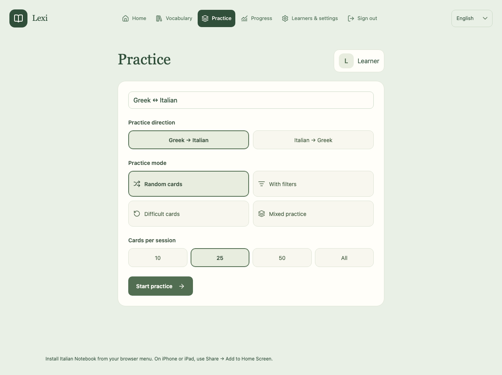
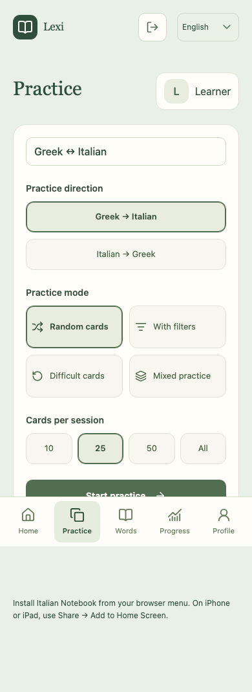
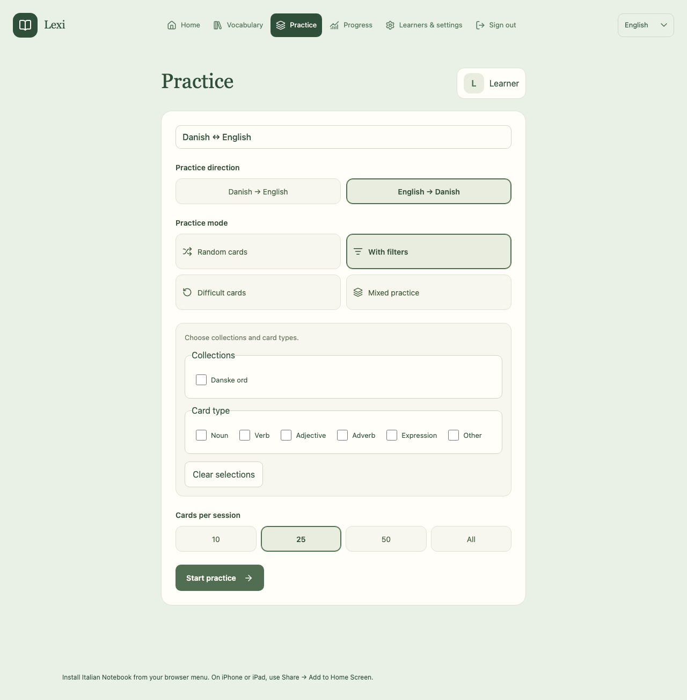
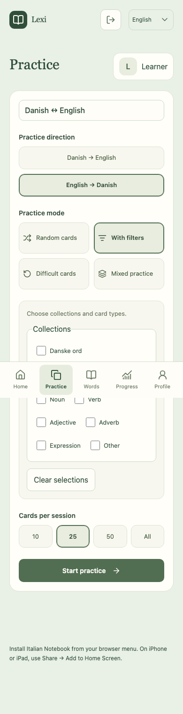
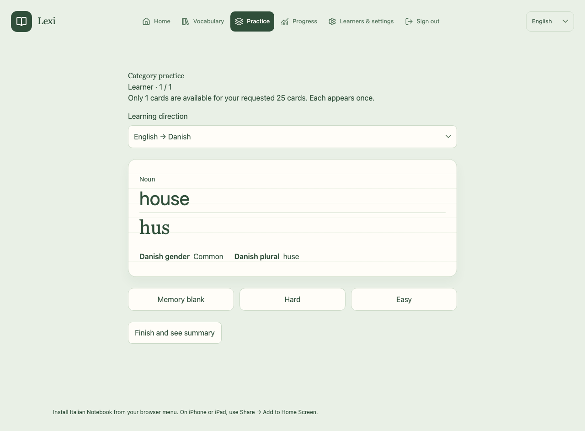
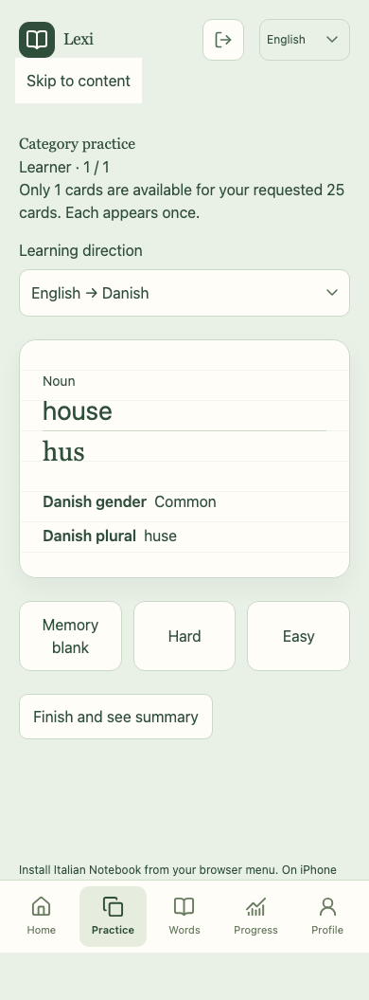

# Multilingual Practice screenshots

Captured from the production build against a local preview API with registry-backed
English/Danish and Arabic/Persian pairs. Both viewports use the same flow: search the
pair picker by native name, choose the explicitly registered direction, verify scoped
collection filters, start a session, and reveal structured Danish grammar.

| Desktop | Mobile |
| --- | --- |
|  |  |
|  |  |
|  |  |
